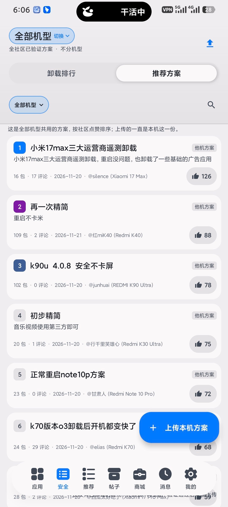
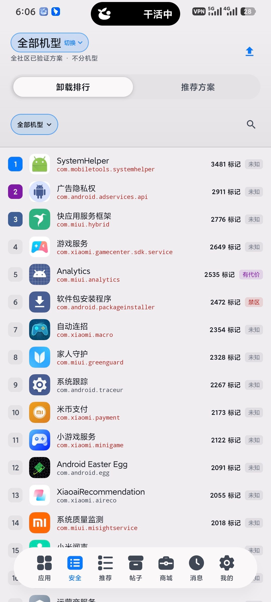
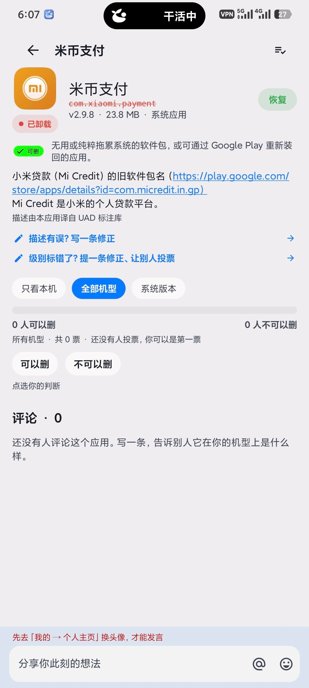

<div align="center">

# Canta · unicanta

**Uninstall pre-installed apps without root**

[中文](README.md) | English

Based on the upstream Canta project, powered by
[Shizuku](https://shizuku.rikka.app/). Application id `io.github.a303562915.unicanta`,
internal codename **unicanta**.

</div>

---

## What this fork changes

Upstream Canta is "pick an app → hit the trash icon → uninstall". This fork fills in what
happens **before and after** that: know what you are about to remove (device rules +
community plans), notice when a removal went wrong (rescue signal + batch guard),
and run **without upstream's servers** (self-hosted telemetry, fully offline capable).

| Area | Upstream | This fork |
|---|---|---|
| UI language | mostly English | full Chinese translation, Chinese app name and settings |
| Application id | `io.github.samolego.canta` | `io.github.a303562915.unicanta` |
| Telemetry backend | upstream server | own Supabase project, or single-file `server/node` |
| Uninstall advice | generic debloat list | safety rules keyed by **brand / model / ROM version** |
| Rescue signal | none | new `restored` event (same build, reinstalled = manual rescue), scored separately |
| Batch uninstall | runs directly | warning before large batches, names packages added since the last batch |
| Community plans | none | upload / read / like / comment, deduplicated by install identity |
| ROM support | some ROMs hide the package list | fallback plus an always-reachable permission entry for HyperOS / MIUI |

---

## The changes in detail

### 1. Self-hosted telemetry

The client (`util/Telemetry.kt`) speaks exactly four RPCs, so switching backends is two constants:

| RPC | Request | Response |
|---|---|---|
| `challenge` | `{}` | `{challenge, sig}`, single-use, valid for 10 minutes |
| `record` | `{payload, challenge, sig, x}` | `{ok, accepted}` |
| `package_scores` | `{}` | global aggregate per package |
| `package_scores_for` | `{p_rom, p_rom_version}` | aggregate for one ROM (`-1` = family-wide) |

Two server implementations behind the same contract. The published repository only ships the
self-hosted one; **the hosted-database side (schema, migrations, scoring fixture and its deployment
notes) is kept local and is not published here.**

- **Single file self-hosting**: `server/node/server.mjs` with embedded SQLite (`node:sqlite`,
  no native modules). Run `node server.mjs`; env: `PORT`, `DB_PATH`, `RETENTION_DAYS`, `POW_K`.

The app points at the self-hosted project by default; override at build time:

```bash
./gradlew :androidApp:assembleDebug \
  -Pcanta.telemetry.baseUrl=https://PROJECT.supabase.co/rest/v1/rpc/ \
  -Pcanta.telemetry.apiKey=PUBLISHABLE_KEY
```

**Proof of work matches the client's `util/Pow.kt`**, so the server never has to trust a client:

```
prefix = challenge + ":" + hex(sha256(payload)) + ":" + x
accept when sha256(prefix), first 8 bytes big-endian, < floor(2^64 / (10000 * event_count))
```

Replaying a challenge is rejected; a tampered payload fails the PoW check.

### 2. The `restored` event and the batch guard

Event kinds: `uninstalled` / `survived_reboot` / `reinstalled` / `voided` / **`restored`**.

`restored` is new here: a package came back while its build number did not change, which only
happens when a human reinstalls it. It is the only source of "this batch rescued a bricked phone",
and the strongest signal in scoring.

Around it: `UnsafeSelectionDialog` warns before oversized batches, packages that appeared after
the previous batch are called out by name, and rescued batches surface separately
(`RestoreSuspectsDialog`).

Scoring thresholds (ours, upstream never published any):

```
uninstalls < 5                               -> INSUFFICIENT
restored / uninstalls >= 15%                 -> BOOTLOOP
(reinstalled + restored) / uninstalls >= 30% -> BOOTLOOP
(reinstalled + restored) / uninstalls >= 10% -> BREAKS
survived >= 50% and the above <= 2%          -> SAFE
otherwise                                    -> UNCLEAR
```

### 3. Device safety page and uninstall rules

`util/SafetyRules.kt` turns "may I remove this?" from a package-name lookup into a **device**
decision: rules ship in `files/safety_rules.json`, matched on `brand / model / rom / romVersion`,
yielding `SAFE` / `RISKY` / `CRITICAL`. The device profile (including the fingerprint) never
leaves the phone — it is precisely what the telemetry opt-in promises not to send.

`SafetyRulesScreen` has two tabs: which rules hit on this device, and the community plan entry point.

### 4. Community plans

`data/community/PlanRepository.kt`: a plan is the set of packages one phone removed, confirmed by
a reboot. Upload, read in full, like, comment. Each install has its own identity; only the uploader
may delete a plan; test uploads are flagged and kept out of the ranking. Backend objects live in the
`plans` migrations (`plan_test_and_owner`, `user_numbers`).

### 5. UI rework

- `FloatingPillBar`: frosted, rounded, icon-over-label, four entries with permanent Chinese labels;
- the first tab is now an uninstall ranking driven by likes;
- denser list rows, wider selected pill;
- a **system tweaks page** (`TweaksScreen` + `util/RomTweaks.kt`) grouped as 小米 / OPPO / vivo / 华为 / 三星,
  this phone's own group first and marked, with no "other" and no "general" group; each card is a tappable
  feature — restore every uninstalled app, which asks how many will come back first, then restores them one
  by one, with the equivalent `pm install-existing` command shown alongside;
- plan detail screen, upload dialog, comment list.

### 6. ROM and permission handling

- `hasInstalledAppsPermission()` now goes through `packageManager.checkPermission(...)` explicitly —
  on some ROMs the old check never returned `true`;
- `com.android.permission.GET_INSTALLED_APPS` is requested at runtime;
- packages are read from the privileged runtime first; when that fails, a dialog asks the user to
  enable the ROM's package-list switch (HyperOS / MIUI);
- that entry point stays reachable in the UI instead of being buried in settings.

### 7. Build and CI

- own `applicationId`, R8 enabled for release with the missing keep rules added;
- a timeout on the Gradle wrapper download so CI cannot hang on the distribution fetch;
- `fork-ci.yml` runs the common tests on **every branch** and produces a debug APK, with
  `workflow_dispatch` inputs to override the telemetry endpoint and key
  (`telemetry_base_url` / `telemetry_api_key`).

---

## Install

Same requirements as upstream: Shizuku (Android 16 may need the
[forked build](https://github.com/thedjchi/Shizuku)).

1. Install and activate [Shizuku](https://shizuku.rikka.app/guide/setup/);
2. Install an APK built from this repository (this fork is published to no store — build it yourself, see below);
3. Pick an app → hit the trash icon.

> [!Warning]
> **DISCLAIMER:** use at your own risk. Uninstalling **critical apps** causes a bootloop that only a
> factory reset fixes. Some oplus apps are known to refuse uninstallation, see the
> upstream tracking issue #338.

## Build

There is **no local build**. This fork has no Android SDK wired up, and `gradlew` is not
executable on purpose — every build runs in GitHub Actions:

- `build.yml` — tests, debug APK, and a signed release APK when the signing secrets are set
  (skipped on `master`, where `development-release.yml` produces the same signed APK)
- `release.yml` — signed release + checksums + attestation, on a `v*` tag or manual dispatch
- `development-release.yml` — the rolling signed `dev` pre-release

Modules: `composeApp` / `androidApp` / `desktopApp` / `webApp` / `packages` / `helper` /
`hiddenApiStubs` (see `settings.gradle.kts`).

## Local regression

```bash
# single-file self-hosted backend
cd server/node && node test/e2e.test.mjs
```

Covers: normal ingestion, challenge replay rejected, tampered payload fails PoW, invalid event kind,
all five verdicts, ROM-version and family-wide queries, `purge_raw_events`.

The hosted-database migration tests (PGlite plus migrations, plan/comment assertions) run locally
only; they are not part of this repository.

## Privacy

- stores only `brand` / ROM family / ROM major version / SDK, plus event kind and batch bucket;
- model, build number, fingerprint and install id are **never** uploaded;
- raw events are dropped after 35 days by `purge_raw_events()`, only aggregates remain;
- the raw tables have RLS enabled with **no policy at all**: anon can only call the RPCs, direct
  table reads return nothing. Internal functions are not exposed to `anon` / `authenticated`.

## Layout

| Path | Contents |
|---|---|
| `composeApp/` | shared UI and business logic (Compose Multiplatform) |
| `androidApp/` | Android shell, manifest, icons |
| `desktopApp/` `webApp/` | desktop and web shells |
| `server/node/` | single-file self-hosted backend plus e2e test |
| `docs/` | VitePress documentation site |
| `packages/` | platform helper packages |

## Distribution

- `release.yml` publishes signed APKs: push a `v*` tag (or dispatch it with `keep_draft=true`
  to get a draft first). Checksums and a build provenance attestation ship with the assets.
- `development-release.yml` publishes a signed rolling build to the `dev` pre-release on every
  push to `master`; `pages.yml` then refreshes <https://303562915.github.io/unicanta/>.

## Credits

- **Canta**: the base project;
- [Universal-Debloater-Alliance](https://github.com/Universal-Debloater-Alliance/universal-android-debloater-next-generation/): debloat list and safety recommendations;
  > The app does **not** talk to the upstream repository directly: `bloat-list-sync.yml` mirrors upstream's
  > `uad_lists.json` into this repository at `site/bloat/bloat_list.json` weekly (with `_sync_meta.json`
  > recording the upstream commit), and the app reads that copy by default. Level objections go to
  > `bloat_overrides.json` / the backend `package_level_fixes` table instead of the upstream file.
- [@RikkaApps](https://github.com/RikkaApps): Shizuku;
- icon from [icon kitchen](https://icon.kitchen).

SHA-256 certificate fingerprint of **upstream** release APKs (not of this fork's builds):

```
0A:26:40:31:7C:43:27:21:88:C3:E1:31:94:C1:54:60:69:1F:12:C3:9E:A1:9B:BA:72:7D:D6:7F:B5:62:89:D4
```

## Screenshots

|  |  |  |
|:---:|:---:|:---:|
| Home | Search | Uninstall |

Taken from upstream; this fork uses the capsule bottom bar and Chinese labels.
