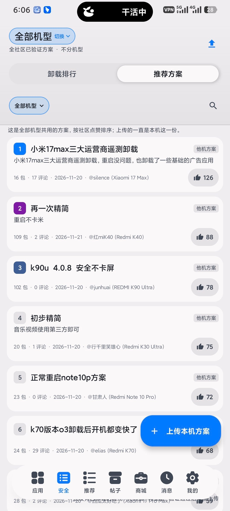
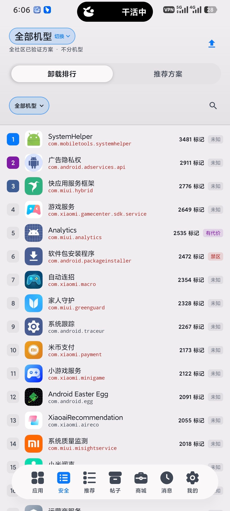
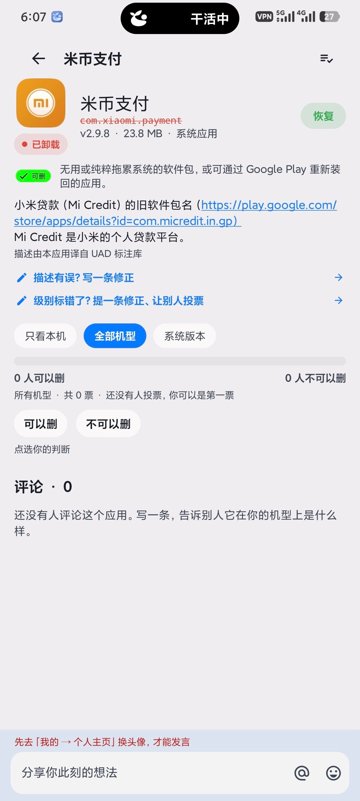

<div align="center">

# Canta · unicanta

**免 root 卸载系统应用 / Uninstall pre-installed apps without root**

中文 | [English](README.en.md)

基于上游 Canta 项目，由 [Shizuku](https://shizuku.rikka.app/) 授权，
包名 `io.github.a303562915.unicanta`，内部代号 **unicanta**。

</div>

---

## 这个 fork 做了什么

上游 Canta 是「选择应用 → 点垃圾桶 → 卸载」。本分支在此基础上补齐了**卸载前后**的三件事：
知道自己删的是什么（设备规则 + 社区方案）、删错了能看出来（救砖信号 + 批量护栏）、
以及**不依赖上游服务器**（自建遥测后端，可完全离线自托管）。

| 方向 | 上游 | 本 fork |
|---|---|---|
| 界面语言 | 英文为主 | 中文全量翻译，应用名与设置项都是中文 |
| 应用 ID | `io.github.samolego.canta` | `io.github.a303562915.unicanta` |
| 遥测后端 | 上游服务器 | 自建 Supabase 项目，或 `server/node` 单文件自托管 |
| 卸载建议 | 通用 debloat 列表 | 按 **品牌 / 机型 / ROM 版本** 判定的安全规则 |
| 救砖信号 | 无 | 新增 `restored` 事件（build 未变却被装回 = 人工救砖），单独计入判分 |
| 批量卸载 | 直接执行 | 大批量前弹告警，列出「上一批之后新装的包」 |
| 社区方案 | 无 | 上传 / 阅读 / 点赞 / 评论，按安装身份去重 |
| ROM 适配 | 部分 ROM 读不到包列表 | HyperOS / MIUI 隐藏包列表的兜底与授权入口 |

---

## 主要改动

### 1. 自建遥测后端

客户端 `util/Telemetry.kt` 只认四个 RPC，所以换后端只是换两个常量：

| RPC | 请求 | 返回 |
|---|---|---|
| `challenge` | `{}` | `{challenge, sig}`，一次性、10 分钟有效 |
| `record` | `{payload, challenge, sig, x}` | `{ok, accepted}` |
| `package_scores` | `{}` | 每个包的全局聚合 |
| `package_scores_for` | `{p_rom, p_rom_version}` | 指定 ROM（`-1` = 家族级）的聚合 |

服务端两种实现，协议完全一致。公开仓库里只发布自托管版本；**托管数据库那一侧（schema、迁移、
判分 fixture 与部署说明）不随仓库发布**，只保留在作者本地。

- **单文件自托管**：`server/node/server.mjs`，内置 SQLite（`node:sqlite`，不编译原生模块），
  `node server.mjs` 就能起，环境变量 `PORT` / `DB_PATH` / `RETENTION_DAYS` / `POW_K`。

客户端默认指向自建项目。构建只在 **GitHub Actions** 里进行，每次 push 自动触发
（测试 → Debug APK → Release APK，见 `.github/workflows/build.yml`）；**本地不编译**，
需要切换遥测后端时在 Actions 里通过 `-Pcanta.telemetry.baseUrl` /
`-Pcanta.telemetry.apiKey` 传入即可。

**Proof of Work 与客户端 `util/Pow.kt` 一致**，服务端不需要信任客户端上报：

```
prefix = challenge + ":" + hex(sha256(payload)) + ":" + x
通过条件：sha256(prefix) 前 8 字节大端 < floor(2^64 / (10000 * 事件数))
```

同一条 challenge 重放会被拒，payload 被篡改则 PoW 校验失败。

### 2. `restored` 事件与批量卸载护栏

事件类型：`uninstalled` / `survived_reboot` / `reinstalled` / `voided` / **`restored`**。

`restored` 是本 fork 新增的：包在 build 号未变的情况下又被装回，只可能是人手动的——
它是「这批卸载救过砖」的唯一数据来源，也是判分里权重最高的信号。

配套的界面行为：卸载批次过大时先弹 `UnsafeSelectionDialog`；上一批之后新出现的包会被点名，
救回过的批次在列表里单独浮出（`RestoreSuspectsDialog`）。

判分阈值（本项目自定，上游未公开）：

```
uninstalls < 5                              -> INSUFFICIENT
restored / uninstalls >= 15%                -> BOOTLOOP
(reinstalled + restored) / uninstalls >= 30% -> BOOTLOOP
(reinstalled + restored) / uninstalls >= 10% -> BREAKS
survived >= 50% 且上面 <= 2%                -> SAFE
其余                                         -> UNCLEAR
```

### 3. 设备安全页与卸载规则

`util/SafetyRules.kt` 把「这个包能不能删」从包名判断升级为**设备判断**：
规则来自 `files/safety_rules.json`，按 `brand / model / rom / romVersion` 匹配，
产出 `SAFE` / `RISKY` / `CRITICAL` 三档。设备画像（含 fingerprint）只在本机使用，
**不上传**——这正是遥测承诺不发的东西。

`SafetyRulesScreen` 两个页签：本机规则的命中情况 + 社区方案入口。

### 4. 社区方案

`data/community/PlanRepository.kt`：方案 = 一台手机删掉的一批包，且已被一次重启验证。
支持上传、完整阅读、点赞、评论；每次安装有独立身份，只有上传者本人能删自己的方案；
测试性上传会被标记，不进正常排名。这些对象由服务端数据库提供，其 schema 不随公开仓库发布。

### 5. 界面重构

- 浮动胶囊底栏 `FloatingPillBar`：磨砂圆角、图标在上文字在下，四个入口常驻中文标签；
- 首个页签改成**按点赞驱动的卸载排行**；
- 列表行更密，选中态是更宽的胶囊；
- **系统技巧页**（`TweaksScreen` + `util/RomTweaks.kt`）：按 小米 / OPPO / vivo / 华为 / 三星 五组排序，
  本机所在组排最前，标题直接写「本机可用」而不是厂商名加一行「你的系统」；只有这五组、没有「其他」和「通用」；组里放的是能点的功能——
  恢复所有已卸载的应用，点一下先弹提醒确认要装回几个，再逐个恢复，并附等价的 `pm install-existing` 命令；
- 方案详情页、上传对话框、评论列表。

### 6. ROM 与权限适配

- `hasInstalledAppsPermission()` 改为显式走 `packageManager.checkPermission(...)`，
  否则部分 ROM 上权限查询永远返回 `false`；
- 运行时请求 `com.android.permission.GET_INSTALLED_APPS`；
- 优先从特权运行时读包列表，读不到时弹对话框引导开启 ROM 的「包列表」开关（HyperOS / MIUI）；
- 该授权入口在界面上常驻，不会被埋进设置里。

### 7. 构建与 CI

- 自有 `applicationId`，release 开 R8 压缩并补齐缺失的 keep 规则；
- Gradle wrapper 下载加超时，避免 CI 卡死在拉 distribution；
- **不在本地编译**：`build.yml` 在**每次 push** 时自动构建——测试 → Debug APK →
  Release APK（配置了签名密钥才跑），产物与测试报告以 artifact 保留；
- `fork-ci.yml` 在**每个分支**上跑通用测试并产出 debug APK，支持 `workflow_dispatch`
  时覆盖遥测端点与 key（`telemetry_base_url` / `telemetry_api_key`）。

---

## 安装

与上游一致：需要 Shizuku（Android 16 建议用 [fork 版](https://github.com/thedjchi/Shizuku)）。

1. 安装并激活 [Shizuku](https://shizuku.rikka.app/guide/setup/)；
2. 安装本仓库构建出的 APK —— 直接去 [下载页](https://303562915.github.io/unicanta/) 或
   [Releases](https://github.com/303562915/unicanta/releases) 取签名包，不需要自己编；
3. 选择应用 → 点垃圾桶。

> [!Warning]
> **免责声明**：使用风险自负。卸载**关键应用**会导致 bootloop，只能恢复出厂设置。
> 部分 oplus 应用已知拒绝卸载，见上游跟踪 issue #338。

## 构建

**不在本地编译**：所有编译都发生在 GitHub Actions 里，**每次 push 自动触发**
（`push` 到任何分支，含 `workflow_dispatch` 手动触发）。

见 [`.github/workflows/build.yml`](.github/workflows/build.yml)，一次完整构建包含：

1. **测试**：`:composeApp:desktopTest`，失败即阻断后面的构建；
2. **Debug APK**：`:androidApp:assembleDebug`，产物与 SHA-256 上传为 artifact；
3. **Release APK**：`:androidApp:assembleRelease`（R8 压缩），仅当仓库配置了签名密钥
   `CANTA_KEYSTORE_BASE64`（另需 `KEYSTORE_PASSWORD` / `KEY_ALIAS` / `KEY_PASSWORD`）时执行，
   未配置则该任务自动跳过，测试与 Debug APK 照常产出。**master 推送时这个 job 不跑**：
   同一次 push 里 `development-release.yml` 已经产出签名 APK，再编一遍只是白烧 runner；
   手动 `workflow_dispatch` 时仍然会跑。

要临时指向别的遥测后端，用 `fork-ci.yml` 的 `telemetry_base_url` / `telemetry_api_key`
两个 dispatch 输入（`build.yml` 没有这组输入）。本地不需要准备 JDK 或 Gradle 缓存。

## 本地回归

```bash
# 自托管单文件后端
cd server/node && node test/e2e.test.mjs
```

覆盖：正常写入、challenge 重放被拒、篡改 payload → PoW 失败、非法事件类型、
五种 verdict、ROM 版本级与家族级查询、`purge_raw_events`。

托管数据库那一侧的迁移测试（PGlite + 迁移 + 方案/评论断言）在本地进行，不随仓库发布。

## 隐私

- 只存 `brand` / ROM 家族 / ROM 主版本 / SDK，以及事件类型与批次桶；
- 机型、build 号、指纹、安装 ID **一律不上传**；
- 原始事件 35 天后由 `purge_raw_events()` 丢弃，只留聚合；
- 原始表开了 RLS 且**没有任何 policy**：anon 只能调 RPC，直读表拿不到数据；
  内部函数不从 `anon` / `authenticated` 开放。

## 目录

| 路径 | 内容 |
|---|---|
| `composeApp/` | 共享 UI 与业务逻辑（Compose Multiplatform） |
| `androidApp/` | Android 壳、清单、图标 |
| `desktopApp/` `webApp/` | 桌面与 web 壳 |
| `server/node/` | 单文件自托管后端 + e2e 测试 |
| `docs/` | VitePress 文档站 |
| `packages/` | 平台相关辅助包 |

## 已知待办

- 本 fork 未做 release 签名与分发；`build.yml` 已支持配置 `CANTA_KEYSTORE_BASE64` 等
  secrets 后产出 Release APK，未配置时自动跳过该任务。

## 致谢

- **Canta**：本项目的基础；
- [Universal-Debloater-Alliance](https://github.com/Universal-Debloater-Alliance/universal-android-debloater-next-generation/)：debloat 列表与安全建议来源；
- [@RikkaApps](https://github.com/RikkaApps)：Shizuku；
- 图标来自 [icon kitchen](https://icon.kitchen)。

上游发行包的 SHA-256 证书指纹（用于校验**上游**发行包，非本 fork 构建产物）：

```
0A:26:40:31:7C:43:27:21:88:C3:E1:31:94:C1:54:60:69:1F:12:C3:9E:A1:9B:BA:72:7D:D6:7F:B5:62:89:D4
```

## 截图

|  |  |  |
|:---:|:---:|:---:|
| 主界面 | 搜索 | 卸载 |

截图取自上游版本，本 fork 的界面已改为胶囊底栏与中文标签。
